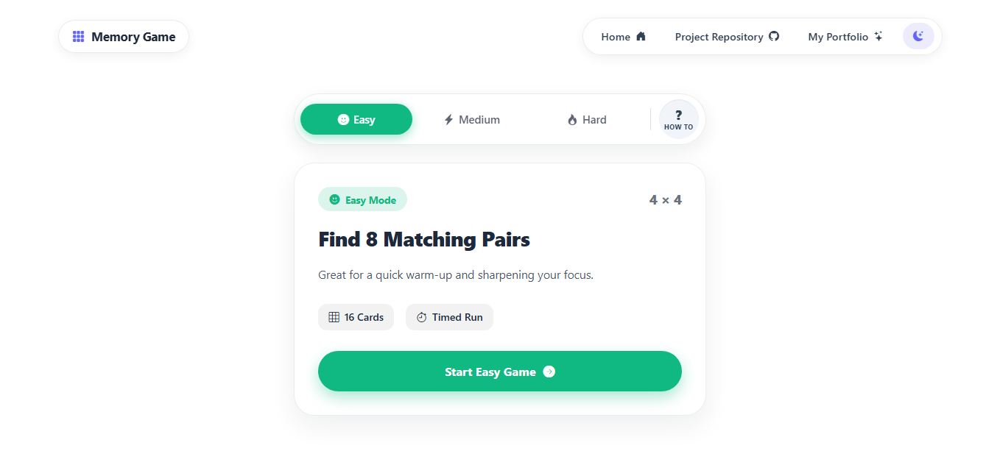

# React Memory Game

A modern, responsive card-matching memory game built with **React**, **React Router**, and custom **Glassmorphism CSS**. Test your focus across three difficulty levels with 3D card-flip animations, live move & timer tracking, and persistent Light/Dark themes.

🔗 **Live Demo:** [react-memory-game-banuaggun.vercel.app](https://react-memory-game-banuaggun.vercel.app/)

---



---

## ✨ Features

- **3 Difficulty Modes:**
  - **Easy:** 4 × 4 grid (8 pairs)
  - **Medium:** 5 × 4 grid (10 pairs)
  - **Hard:** 6 × 4 grid (12 pairs)
- **3D Card Flip Animations:** Smooth `rotateY` card transitions with visual feedback for matched pairs and mismatches.
- **Floating Glassmorphic UI:** Responsive floating navigation bar with a mobile FAB Speed-Dial menu and a unified Game Dock selector.
- **Interactive How-To Guide:** Built-in step-by-step instructions right on the home screen.
- **Persistent Light & Dark Theme:** Automatically remembers your theme preference via `localStorage`.
- **Victory Summary & Quick Restart:** Displays total moves and completion time with one-click replay or level switching.

---

## 🛠️ Technologies Used

- **React 18** (Hooks, Functional Components)
- **React Router v6** (Client-side routing)
- **Custom CSS3** (CSS Grid, Flexbox, Glassmorphism, 3D Transforms & Keyframe Animations)
- **Bootstrap Icons**

---

## 🚀 Getting Started

1. **Clone the repository:**

   ```bash
   git clone https://github.com/banuaggun/react-memory-game.git
   cd react-memory-game
   ```

2. **Install dependencies:**

   ```bash
   npm install
   ```

3. **Run the development server:**
   ```bash
   npm start
   ```
   Open [http://localhost:3000](http://localhost:3000) to view it in your browser.
